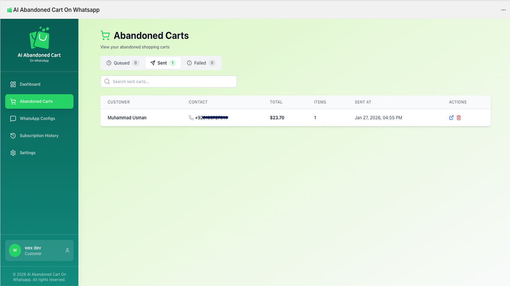
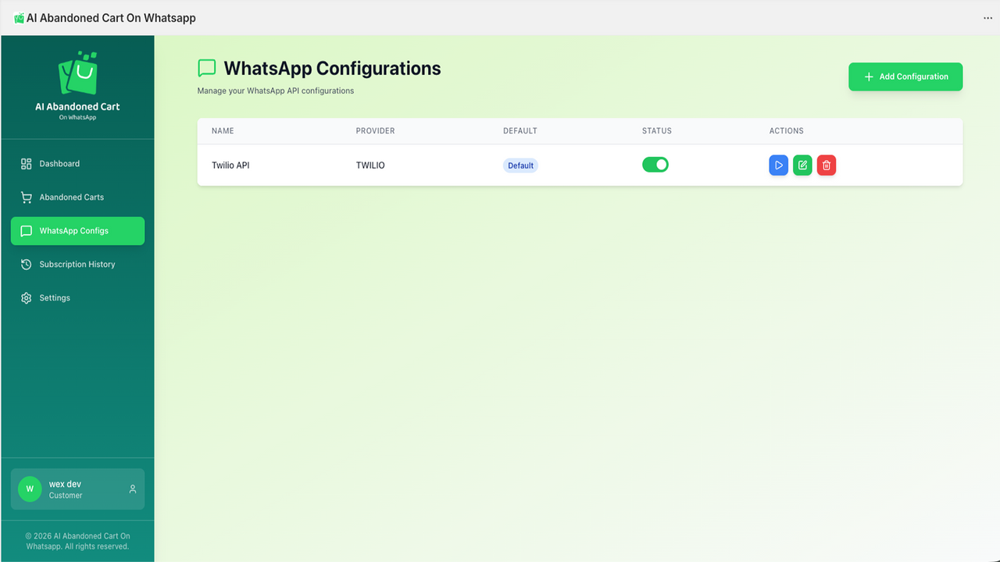
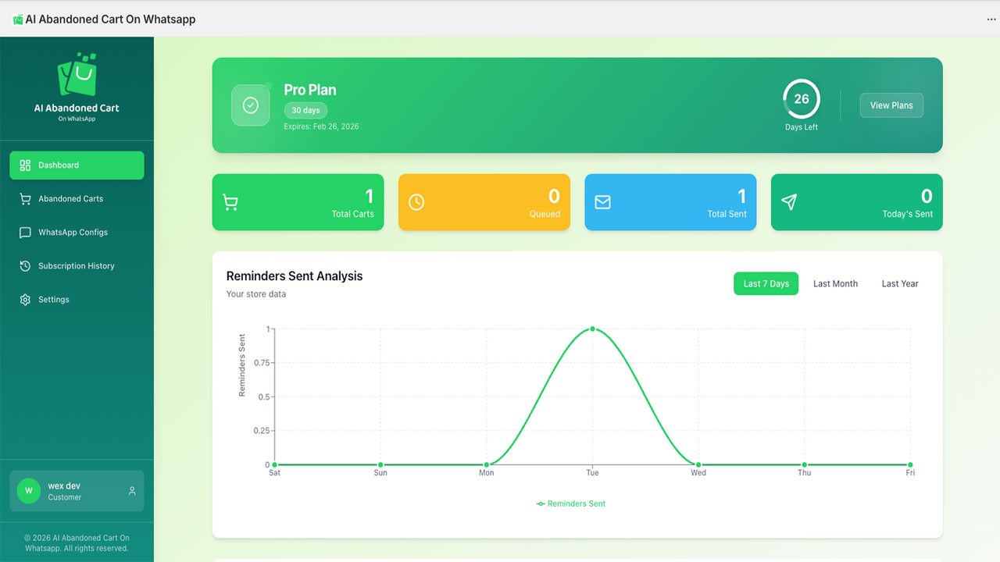
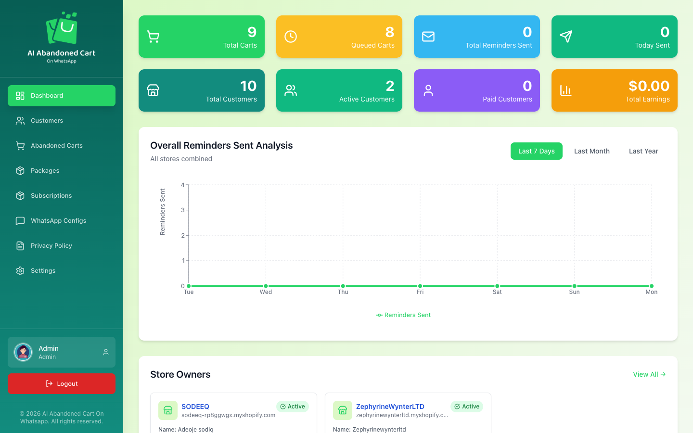
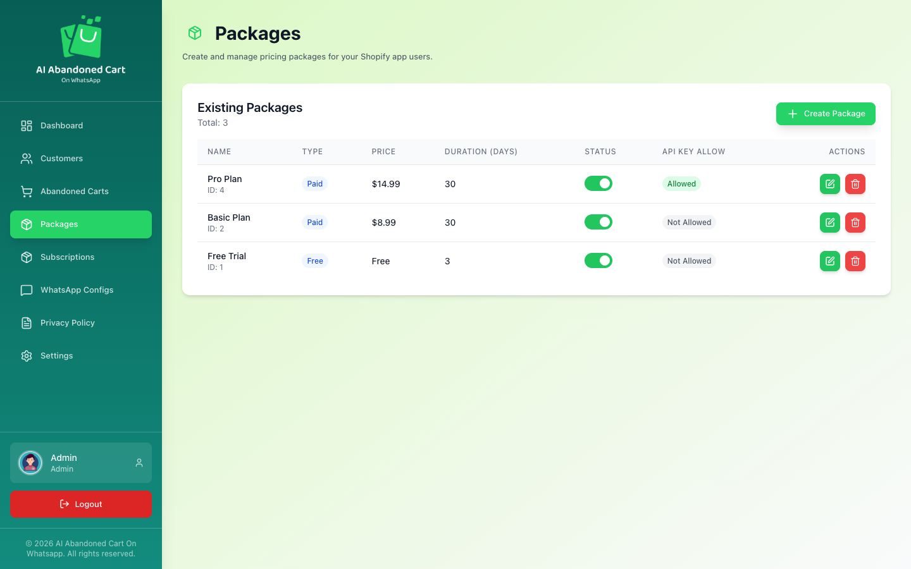
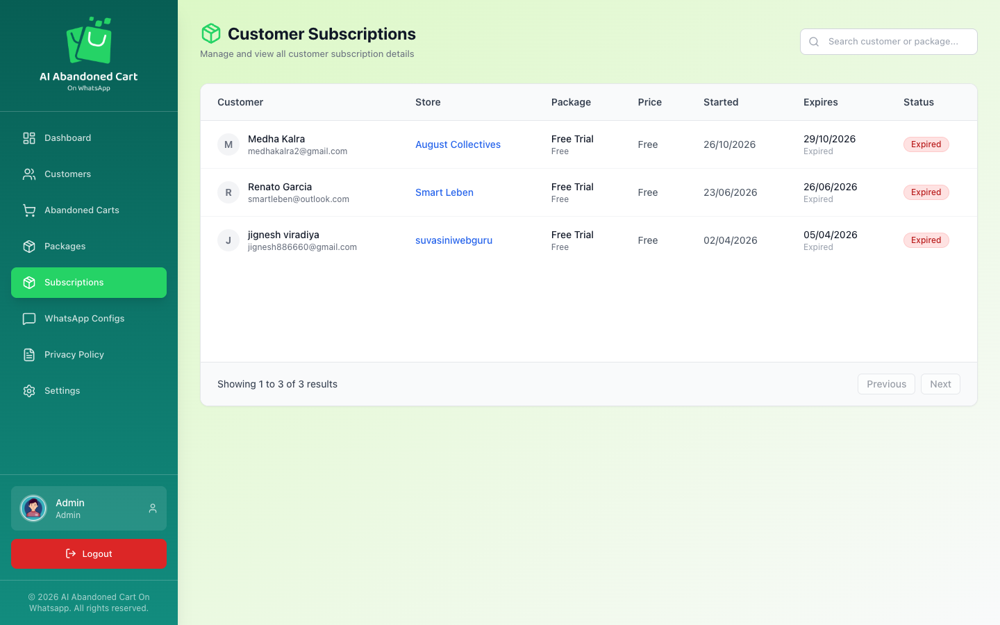
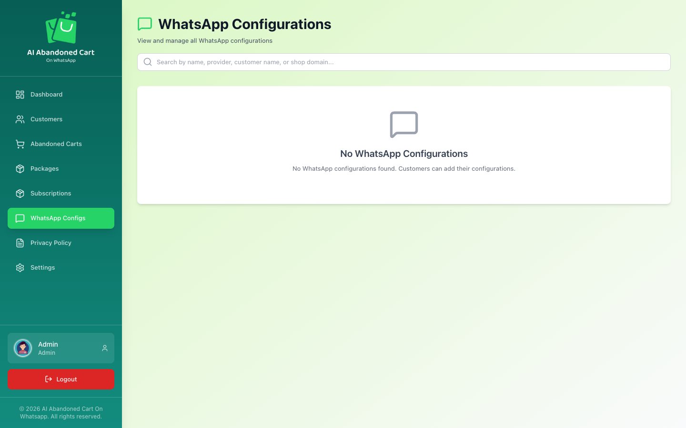
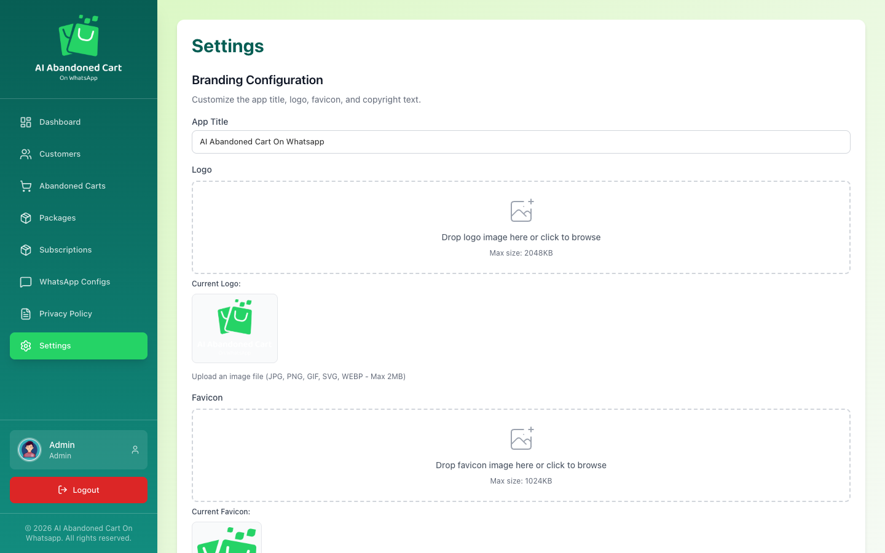

# AI Abandoned Cart on WhatsApp — Frontend

Shopify embedded admin app (**Next.js / React / TypeScript**) for recovering abandoned carts via WhatsApp — manual sends and automated flows with merchant WhatsApp API configs.

**Live on Shopify App Store:** [AI Abandoned Cart On Whatsapp](https://apps.shopify.com/aboundent-cart-whatsapp)

**Admin panel (demo):** [abandoned-cart-frontend.taskolia.com](https://abandoned-cart-frontend.taskolia.com/)

> **Full-stack delivery:** I built **both** this frontend **and** the paired **Laravel** backend (auth, carts, WhatsApp configs, billing, reminders). This public repo is the frontend only — Laravel API source is not included here.

---

## Overview

Merchants lose revenue when shoppers abandon checkout. This app reconnects them on WhatsApp:

- View abandoned carts in real time inside Shopify Admin
- Send recovery messages manually or on a delay schedule
- Connect the merchant’s own WhatsApp API for automation
- Track delivery logs, templates, packages/subscriptions, and customer settings (DND / daily limits)

Built as a **Shopify embedded app** with App Bridge + Polaris, talking to a Laravel backend over authenticated APIs.

---

## Role & responsibility

| Area | Contribution |
|------|----------------|
| Frontend | Next.js 14 App Router, TypeScript, App Bridge, Polaris, Tailwind |
| Backend (not in this repo) | **Laravel** REST API — auth, carts, WhatsApp, billing, cron/reminders |
| Shopify | Embedded UX, session token bridge, billing / packages |
| Product UI | Admin dashboard, carts, customers, configs, templates, settings |

---

## Tech stack

| Layer | Technologies |
|-------|----------------|
| Frontend | **Next.js 14**, **React 18**, **TypeScript** |
| Shopify | **@shopify/app-bridge**, **@shopify/app-bridge-react**, **@shopify/polaris** |
| Styling | **Tailwind CSS**, Polaris, WhatsApp-oriented branding |
| HTTP | **Axios** |
| Charts / UI | **Recharts**, **Lucide**, **React Quill**, **React Toastify** |
| Backend (paired) | **Laravel** REST API |

---

## Screenshots

### Merchant app (Shopify Admin / App Store)

<p align="center">
  
</p>

<p align="center">
  
</p>

<p align="center">
  
</p>

### Admin panel

<p align="center">
  
</p>

<p align="center">
  
</p>

<p align="center">
  
</p>

<p align="center">
  
</p>

<p align="center">
  
</p>

---

## App modules (frontend)

```
app/
├── page.tsx                 # Dashboard
├── abandoned-carts/         # Cart list & recovery actions
├── whatsapp-configs/        # Merchant WhatsApp API configs
├── message-templates/       # WhatsApp message templates
├── customers/               # Customer-related views
├── packages/                # Pricing plans
├── select-package/          # Plan selection (Shopify billing flow)
├── subscription-history/    # Billing history
├── settings/                # DND & daily limits
├── profile / login / register / set-password
└── admin/subscriptions/     # Admin subscription management

components/                  # App Bridge bridge, guards, nav, layout
lib/                         # Auth, axios, session token helpers
contexts/                    # Embedded path & timezone
```

---

## Product highlights (from live listing)

- Manual WhatsApp messages for abandoned carts  
- Automated messaging via merchant WhatsApp API keys  
- Custom delay before send  
- Real-time abandoned cart tracking  
- Dashboard analytics  
- Free + paid plans ($8.99 / $14.99 monthly tiers on App Store)

---

## Local setup (dev)

```bash
npm install
cp .env.example .env.local   # if present, or create manually
npm run dev
```

Example env (placeholders only — never commit real keys):

```env
NEXT_PUBLIC_SHOPIFY_API_KEY=your_shopify_api_key
NEXT_PUBLIC_APP_URL=http://localhost:3000
NEXT_PUBLIC_API_URL=http://localhost:8000/api
```

Requires a running Laravel API with CORS + auth configured.

---

## Notes

- This repository is the **merchant-facing React/Next.js frontend** of a production Shopify app.  
- The **Laravel backend** was also implemented by me; it is **not** published in this repo.  
- Credentials and production `.env` files are **not** included.  
- Built while working with WebExert; listed publicly on the [Shopify App Store](https://apps.shopify.com/aboundent-cart-whatsapp).

---

## Author

**Muhammad Usman** — Full-Stack Developer  
[GitHub](https://github.com/usman-wurfel) · [LinkedIn](https://www.linkedin.com/in/muhammad-usman-ali-311418221)
